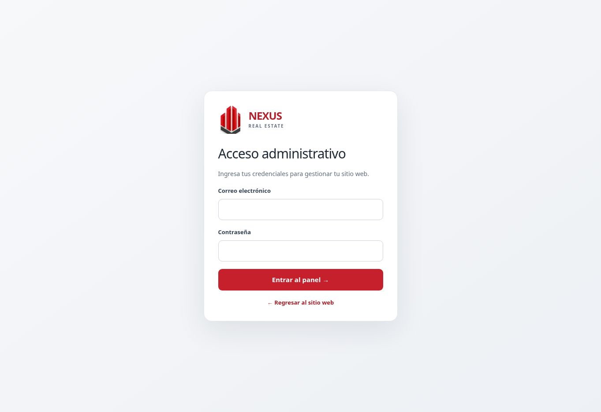

# Nexus: revisión y correcciones visuales — 5 de noviembre de 2026

Estado: **validación visual incompleta; no fusionar todavía**.

## Evidencia de esta revisión

1. **Página pública** (`https://nexusrealestatenicaragua.com`): bloqueada por un 404 de Next.js en el navegador. No se pudo inspeccionar el diseño real ni confirmar la causa del 404. No se atribuye su resolución a este PR.
2. **Acceso administrativo** (`/admin/acceso`): carga correctamente y muestra el logo original, campos con etiquetas y botón de acceso. Esta observación no verifica autenticación ni dashboard.
3. **Dashboard**: requiere una sesión autenticada; no se accedió a datos de producción. Pendiente de revisión visual.
4. **Vista local**: el navegador remoto no alcanza el servidor de desarrollo (localhost: conexión rechazada; terminal.local: bloqueado). Las comprobaciones HTTP se ejecutaron dentro del mismo entorno aislado que el servidor, sin base de datos.

## Comparación con el historial

Se comparó `main` en `748992a` con la copia inicial independiente `1366be9`, y se revisaron `7801971` (identidad), `2797b50` (simplificación) y `b71d064` (separación CSS y LCP).

El logo local `public/brand/nexus-icon.webp`, la composición oscura con fotografía, los colores y los textos de marca siguen presentes. No corresponde sustituirlos por un diseño nuevo. Las reglas de altura incompatibles ya estaban en el historial: el contenedor interior compacto coexistía con un mínimo exterior de 635px (595px en móvil). La revisión del historial es evidencia de código, no una comparación visual entre versiones ejecutadas.

## Cambios

- Imágenes de marca, propiedades y páginas, además de metadatos, usan la misma resolución de dominio público que la portada. Antes usaban directamente `Host`, que puede ser el backend de Enhance. Se conservan los controles de publicación y permisos.
- La variante www/apex también funciona cuando llega por `X-Forwarded-Host` desde un backend privado. Se mantiene el rechazo de dominios ajenos, puertos distintos y encabezados malformados. No se modifica la validación de formularios ni autenticación.
- Si falla el logo personalizado de Nexus, se utiliza el icono original local, sin bucles de recarga. La identidad textual permanece visible.
- Se elimina el mínimo exterior sobrante del hero, se reducen las alturas interiores móvil/tablet y se conserva la fotografía, sus degradados y el contenido editable.
- Se contienen columnas de búsqueda y formularios, se evita comprimir el icono, se permiten encabezados largos y se elimina el mínimo de título heredado en filas compactas de propiedades.
- Se refuerza el foco visible del panel, campos de 16px y controles móviles de al menos 44px en las áreas modificadas.

## Validación

- 15 pruebas de `tests/public-request-origin.test.ts`: aprobadas.
- TypeScript (`npx tsc --noEmit`): aprobado.
- Compilación de Next.js y generación de clientes Prisma MySQL/PostgreSQL: aprobadas. Generar clientes no conecta ni migra bases de datos.
- `check-nexus-classic-restored.mjs`: aprobado sobre servidor de producción local con vista previa explícita y datos demo; comprueba seis rutas públicas y conserva componentes y enlaces.
- `check-style-modules.mjs`: aprobado.
- `check-enhance-ready.mjs`: aprobado, sin configuración SQL en el entorno local.
- `git diff --check`: aprobado.

No se crearon ni modificaron bases de datos. Las pruebas SQL de GitHub usan servicios desechables de CI; no equivalen a validación de producción.

## Pendiente antes de aprobar

- Resolver/diagnosticar el 404 real con el dominio y encabezados efectivos de Enhance, sin asumir que este PR lo corrige.
- Comparar antes/después en 375, 768, 1024 y 1440px para portada, catálogo, dashboard y formulario de propiedad.
- Verificar carga real del logo personalizado, navegación móvil, Tab/Escape, zoom, contraste calculado y reducción de movimiento.
- Verificar propiedades, agentes, CRM y PDF con sesión y datos de prueba. No hay declaración de conformidad WCAG ni aprobación visual completa.

Se consultaron las instrucciones de diseño integradas en el repositorio. La instalación global de UI UX Pro Max falló por permisos; el intento local mediante npx quedó bloqueado por la autorización de red. No se afirma haber ejecutado sus analizadores. No se añadieron dependencias al proyecto.
